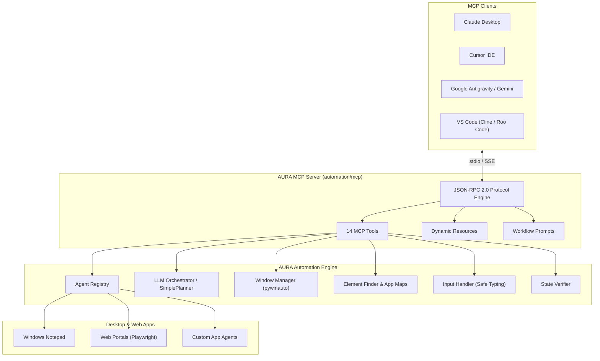

# AURA MCP Server: Complete Integration & Reference Guide

Welcome to the **AURA Model Context Protocol (MCP)** integration!

This MCP server transforms **AURA (Agentic UI Routing Assistant)** into an extensible desktop & browser automation backend accessible by **Claude Desktop**, **Cursor IDE**, **Google Antigravity**, **VS Code (Cline / Roo Code)**, **Windsurf**, and any MCP-compliant AI assistant.

---

## 🌟 Key Capabilities

- 🤖 **Natural Language Automation**: Route complex desktop instructions to specialized agents automatically.
- ⚡ **14 Built-In MCP Tools**: Full desktop control including window management, element locating, safe typing, keyboard shortcuts, screenshots, and state verification.
- 📡 **Dynamic Resources (`aura://...`)**: Live inspect system health, active open windows, discovered agents, and UI App Maps.
- 💡 **Workflow Prompts**: Pre-configured prompts for task orchestration, agent scaffolding, UI tree debugging, and safety auditing.
- 🛡️ **Zero Key-Bounce Guarantee**: Uses clipboard-safe typing to avoid Windows 11 UWP repeat-key glitches.
- 🔌 **Plug-and-Play Plugin Architecture**: Automatically discovers any new agent added to `automation/agents/*_agent.py`.
- 🌐 **Dual Transport**: Supports standard **stdio** (JSON-RPC 2.0) and **HTTP/SSE** on port 8000.

---

## 🏗️ Architecture



---

## 🚀 Quickstart

### 1. Installation

```bash
# Clone or navigate to the repository
cd AURA

# Install dependencies
pip install -r requirements.txt

# Or install in editable mode with MCP console entrypoint
pip install -e .
```

### 2. Run the MCP Server

```bash
# Default stdio mode (for Claude, Cursor, Cline):
python mcp_server.py

# Or via package entrypoint:
aura-mcp

# Or start in HTTP / SSE mode:
python mcp_server.py --transport http --port 8000
```

### 3. Generate Client Configuration Files

Generate ready-to-copy JSON configuration files automatically:

```bash
python mcp_server.py --generate-configs
```

---

## 🛠️ MCP Tools Reference (14 Tools)

| Tool Name | Description | Required Parameters |
|:---|:---|:---|
| `aura_execute_prompt` | Executes a natural language goal across AURA agents (with optional `dry_run` plan preview). | `prompt` (string) |
| `aura_list_agents` | Lists all discovered agents, their actions, schemas, and live status. | *None* |
| `aura_get_agent_info` | Retrieves detailed metadata and action schemas for a single agent. | `agent_name` (string) |
| `aura_execute_agent_action` | Directly triggers an action on a specific agent (e.g. `notepad.open`, `notepad.type`). | `agent_name` (string), `action` (string) |
| `aura_list_windows` | Lists all currently open top-level application windows on the desktop. | *None* (optional: `title_filter`, `visible_only`) |
| `aura_focus_window` | Brings a window matching title/class to the foreground and focuses it. | `title_contains` (string) or `class_name` |
| `aura_launch_app` | Launches an executable and waits for its window to appear. | `executable` (string) |
| `aura_close_window` | Gracefully closes a window. | `title_contains` (string) |
| `aura_inspect_window` | Traverses the live UIA accessibility tree of a window down to `max_depth`. | `title_contains` (string) |
| `aura_find_element` | Finds a specific UI element in a window using multi-property scoring. | `window_title` (string) |
| `aura_send_input` | Sends safe keyboard input: `'text'` (clipboard typing), `'hotkey'` (`ctrl+s`), or `'key_sequence'`. | `input_type` (string), `value` (string) |
| `aura_verify_state` | Verifies desktop state (`window_exists`, `window_closed`, `text_contains`, `element_exists`). | `verification_type` (string), `expected_value` (string) |
| `aura_get_app_map` | Retrieves the parsed UI App Map JSON for an application. | `app_name` (string) |
| `aura_take_screenshot` | Captures a screenshot of a window or desktop (returns base64 or saves to file). | *None* (optional: `window_title`, `save_path`) |

---

## 📡 Dynamic Resources Reference (`aura://...`)

| URI | Name | MIME Type | Description |
|:---|:---|:---|:---|
| `aura://system/status` | System Status | `application/json` | Real-time health, platform info, agent counts, and feature flags. |
| `aura://agents` | Registered Agents | `application/json` | Overview of all active agents and their capabilities. |
| `aura://agents/{agent_name}` | Single Agent Info | `application/json` | Deep metadata and action schemas for `{agent_name}`. |
| `aura://windows/open` | Active Windows | `application/json` | Live list of all visible desktop application windows. |
| `aura://app-maps` | App Maps Index | `application/json` | Index of all available UI App Map definitions. |
| `aura://app-maps/{app_name}` | Single App Map | `application/json` | Full UI element tree and selectors for `{app_name}`. |

---

## 💡 Workflow Prompts Reference

| Prompt Name | Description | Arguments |
|:---|:---|:---|
| `aura_orchestrate_task` | Guides an LLM to plan, verify, and execute complex desktop automation tasks. | `goal` (required), `context` (optional) |
| `aura_build_new_agent` | Step-by-step developer assistant for creating new agents and app maps. | `app_name` (required), `executable` (required), `actions_needed` (optional) |
| `aura_debug_ui_tree` | Diagnoses UI element resolution issues and generates robust app map entries. | `window_title` (required), `target_element` (optional) |
| `aura_safety_review` | Audits an action sequence for destructive or sensitive operations before running. | `proposed_actions` (required) |

---

## ⚙️ Client Configuration Examples

### 1. Claude Desktop

Add this to `%APPDATA%\Claude\claude_desktop_config.json`:

```json
{
  "mcpServers": {
    "aura": {
      "command": "python",
      "args": ["-m", "automation.mcp"],
      "cwd": "C:\\path\\to\\AURA",
      "env": {
        "PYTHONPATH": "C:\\path\\to\\AURA",
        "PYTHONUNBUFFERED": "1"
      }
    }
  }
}
```

### 2. Cursor IDE

Add this to `.cursor/mcp.json` or Cursor MCP settings:

```json
{
  "mcpServers": {
    "aura": {
      "command": "python",
      "args": ["-m", "automation.mcp"],
      "cwd": "C:\\path\\to\\AURA",
      "env": {
        "PYTHONPATH": "C:\\path\\to\\AURA"
      }
    }
  }
}
```

### 3. Google Antigravity / Gemini

Add this to your `.gemini/antigravity.json` or run with `agy`:

```json
{
  "mcp": {
    "servers": {
      "aura": {
        "command": "python",
        "args": ["-m", "automation.mcp"],
        "cwd": "C:\\path\\to\\AURA",
        "env": {
          "PYTHONPATH": "C:\\path\\to\\AURA"
        }
      }
    }
  }
}
```

### 4. VS Code (Cline / Roo Code)

Add this to `cline_mcp_settings.json`:

```json
{
  "mcpServers": {
    "aura": {
      "command": "python",
      "args": ["-m", "automation.mcp"],
      "cwd": "C:\\path\\to\\AURA",
      "env": {
        "PYTHONPATH": "C:\\path\\to\\AURA"
      },
      "disabled": false,
      "autoApprove": [
        "aura_list_agents",
        "aura_get_agent_info",
        "aura_list_windows",
        "aura_inspect_window",
        "aura_find_element",
        "aura_get_app_map"
      ]
    }
  }
}
```

---

## 🧪 Running Tests

Execute the automated test suite to verify protocol compliance:

```bash
pytest
```

All 18 tests cover JSON-RPC 2.0 handshakes, ping, tool discovery, tool execution, resource reading, prompt generation, error handling, and agent execution.
